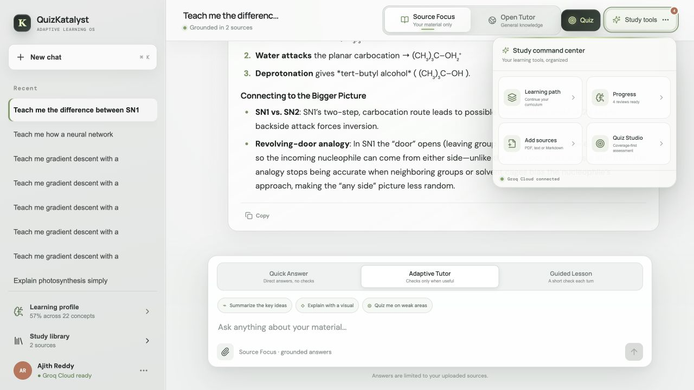
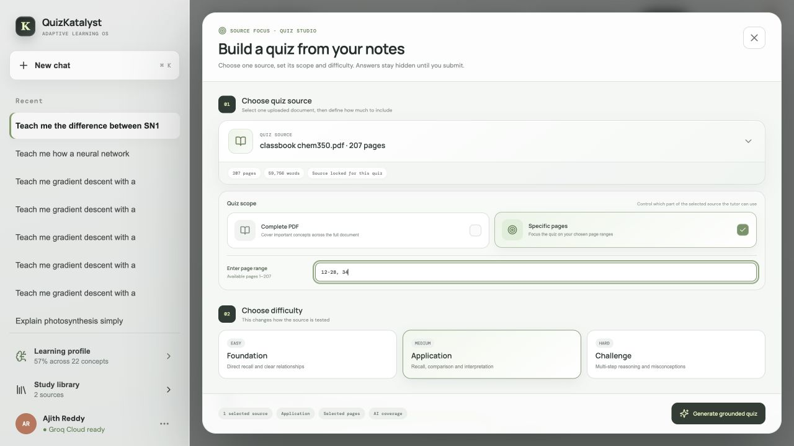
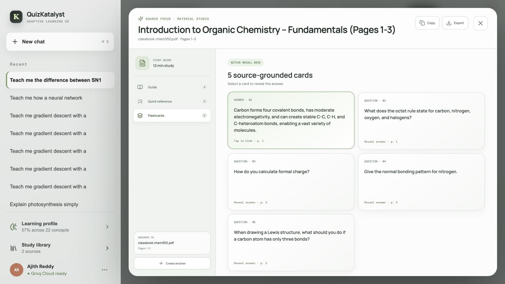
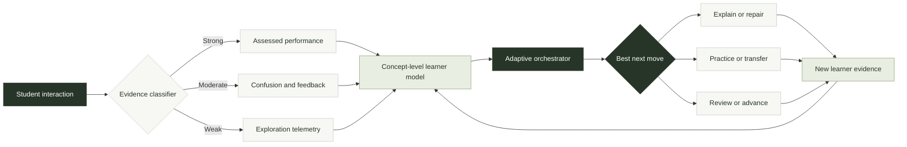
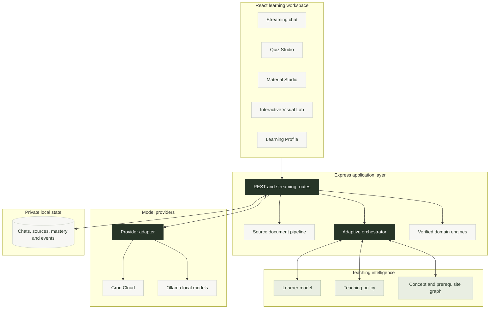

<div align="center">

# QuizKatalyst

### An adaptive AI learning workspace that teaches, checks, and evolves with the learner.

<p>
  
  
  
  
  
</p>

<p>
  <a href="#-why-quizkatalyst">Why QuizKatalyst</a> ·
  <a href="#-product-experience">Experience</a> ·
  <a href="#-how-the-adaptive-loop-works">Adaptive loop</a> ·
  <a href="#-architecture">Architecture</a> ·
  <a href="#-run-locally">Run locally</a>
</p>

</div>



QuizKatalyst is an open-source personalized AI tutor for active learning—not just answer generation. It combines streaming conversation, document-grounded tutoring, adaptive checks, source-aware quizzes, study-material generation, and interactive learning canvases in one focused workspace.

The system keeps a private concept-level learner model and uses observed evidence to decide what should happen next: explain differently, repair a misconception, rebuild a prerequisite, provide practice, test transfer, schedule review, or move forward.

> **Core principle:** the language model communicates; the learning system decides how to teach.

## ✦ Why QuizKatalyst

Most AI study tools produce the same kind of response for every learner. QuizKatalyst closes the loop between teaching and evidence.

| Typical AI chat | QuizKatalyst |
| --- | --- |
| Gives an answer and waits | Selects the next useful teaching action |
| Treats every interaction equally | Weights evidence by reliability |
| Forgets what the learner struggled with | Tracks mastery and misconceptions per concept |
| Uses uploaded files as loose context | Provides a strict source-grounded mode |
| Generates fixed-length quizzes | Covers important concepts across the selected scope |
| Treats clicks as understanding | Uses interaction telemetry only as weak evidence |

## ✦ Product experience

### Two tutoring modes

- **Open Tutor** — broad tutoring for explanations, exploration, examples, and general knowledge.
- **Source Focus** — answers, quizzes, and materials grounded only in uploaded PDF, text, or Markdown sources.

### One connected learning workspace

| Experience | What it does |
| --- | --- |
| **Adaptive Tutor** | Streams responses and asks checks only when they add learning value. |
| **Quiz Studio** | Builds grounded quizzes from a full document or selected PDF pages, at a learner-selected difficulty. |
| **Material Studio** | Generates study guides, revision notes, quick references, flashcards, source proof, micro-checks, and alternate explanations. |
| **Learning Paths** | Extracts concepts, maps prerequisites, ranks importance, audits coverage, and recommends the next step. |
| **Interactive Visual Lab** | Creates draggable concept maps, live variables, predictions, comparisons, chemistry tools, and math explorers. |
| **Learning Profile** | Maintains concept mastery, confidence, misconceptions, strategy performance, and review timing. |
| **Chat Workspace** | Supports streaming, saved history, automatic titles, renaming, pinning, and deletion. |

<table>
  <tr>
    <td width="50%">
      
      <p align="center"><strong>Quiz Studio</strong><br><sub>Choose a source, scope, and difficulty while AI protects concept coverage.</sub></p>
    </td>
    <td width="50%">
      
      <p align="center"><strong>Material Studio</strong><br><sub>Turn selected source material into active, revisable learning assets.</sub></p>
    </td>
  </tr>
</table>

## ✦ How the adaptive loop works



### Evidence is not treated equally

| Evidence tier | Reliability | Examples | How it is used |
| --- | --- | --- | --- |
| **Strong** | High | Assessed chat answers, completed quizzes, verified chemistry predictions | Can substantially update mastery |
| **Moderate** | Medium | Explicit confusion, alternate-explanation requests, learner feedback | Adjusts strategy and flags possible gaps |
| **Weak** | Low | Canvas movement, exploration behavior, self-reported understanding | Guides attention; never proves mastery |

The orchestrator can choose among diagnostic checks, concise explanations, guided practice, misconception repair, prerequisite rebuilding, application, transfer, spaced retrieval, and advancement. Cadence guardrails prevent the tutor from interrupting the learner with a question after every response.

## ✦ Architecture



### Design decisions

- **Adapt state, not shared model weights.** Every learner gets an independent profile without continuously retraining the LLM.
- **Keep pedagogy deterministic where possible.** The orchestrator and teaching policy sit outside the model prompt.
- **Ground source workflows.** Source Focus limits the context used for answers, quizzes, and generated materials.
- **Verify high-risk interactions.** Deterministic domain engines are used when correctness must not depend on plausible text generation.
- **Keep providers replaceable.** Groq is the fast hosted option; Ollama is the private local fallback.

## ✦ Repository map

```text
QuizKatalyst/
├── frontend/
│   ├── src/
│   │   ├── main.jsx              Chat, quiz, materials, canvas and profile UI
│   │   └── styles.css            Product design system
│   ├── index.html
│   └── vite.config.js
├── backend/
│   ├── src/
│   │   ├── server.js             API routes and feature integration
│   │   ├── adaptive-orchestrator.js
│   │   ├── learner-model.js
│   │   ├── teaching-policy.js
│   │   ├── learning-path.js
│   │   ├── source-documents.js
│   │   ├── chemistry-engine.js
│   │   └── llm-provider.js
│   ├── scripts/                  Automated and integration tests
│   └── .env.example              Safe provider configuration template
├── docs/assets/                  README product imagery
└── README.md
```

## ✦ Technology

| Layer | Technology |
| --- | --- |
| Frontend | React 18, Vite, React Flow, Lucide icons |
| Backend | Node.js, Express, streaming responses |
| Model providers | Groq-compatible chat completions, Ollama fallback |
| Documents | Multer uploads, `pdf-parse`, grounded page-aware context |
| Persistence | Local JSON storage for the current single-user build |
| Evaluation | Deterministic scenario, API, retry, chemistry, source, and learning-path tests |

## ✦ Run locally

### Prerequisites

- Node.js 20 or newer
- npm
- A Groq API key **or** a running Ollama installation

### 1. Configure and start the backend

```bash
cd backend
npm install
cp .env.example .env
```

Add your provider configuration to `backend/.env`, then start the API:

```bash
npm run dev
```

The backend starts at `http://127.0.0.1:8787`.

### 2. Start the frontend

In a second terminal:

```bash
cd frontend
npm install
npm run dev -- --host 127.0.0.1
```

Open `http://127.0.0.1:5173/`.

## ✦ Provider configuration

```env
# Fast hosted inference
LLM_PROVIDER=groq
GROQ_API_KEY=your_key_here
GROQ_TUTOR_MODEL=openai/gpt-oss-120b
GROQ_EVALUATOR_MODEL=openai/gpt-oss-20b

# Private local fallback
OLLAMA_URL=http://127.0.0.1:11434
OLLAMA_MODEL=phi3:latest
OLLAMA_EVALUATOR_MODEL=phi3:latest

PORT=8787
```

Set `LLM_PROVIDER=ollama` to use the local provider. Never place provider keys in frontend variables or commit `backend/.env`.

## ✦ Test the system

```bash
# Backend engine, API, and integration suite
cd backend
npm test

# Focused adaptive-orchestrator scenarios
npm run test:orchestrator

# Production frontend build
cd ../frontend
npm run build
```

The suite covers learner-state updates, teaching policies, 14 orchestration scenarios, quiz-to-mastery integration, duplicate-submission protection, Groq streaming retries, chemistry behavior, source processing, and learning-path generation.

## ✦ Privacy and safety

- API keys stay in `backend/.env` and never enter the browser bundle.
- Chats, source metadata, learning events, and learner history stay in the ignored local `backend/data.json` file.
- One learner's memory is never written into shared model weights.
- Source Focus is designed to refuse unsupported information outside uploaded material.
- Canvas activity is treated as behavioral context, not proof of understanding.
- Generic simulations are labeled conceptual.
- Unsupported chemistry combinations are rejected instead of guessed.

## ✦ Roadmap

- [ ] First-run provider selection for Groq or local Ollama
- [ ] Authentication and a production database for multi-user deployment
- [ ] Deterministic learning plugins for mathematics, physics, finance, and science
- [ ] Learner-profile and study-history export/import
- [ ] Accessibility and performance audits
- [ ] Model-quality and pedagogical-effectiveness benchmarks

## ✦ Contributing

QuizKatalyst is in active development. Bug reports, design feedback, test cases, domain engines, and pedagogical improvements are welcome. Before opening a large pull request, start with an issue describing the learner problem and the evidence you will use to verify the improvement.

<div align="center">
  <br>
  <strong>Build for understanding, not just answers.</strong>
  <br><br>
  <sub>QuizKatalyst · Adaptive learning, grounded in evidence</sub>
</div>
